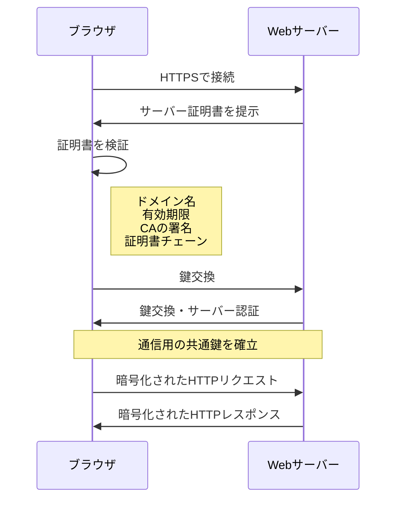
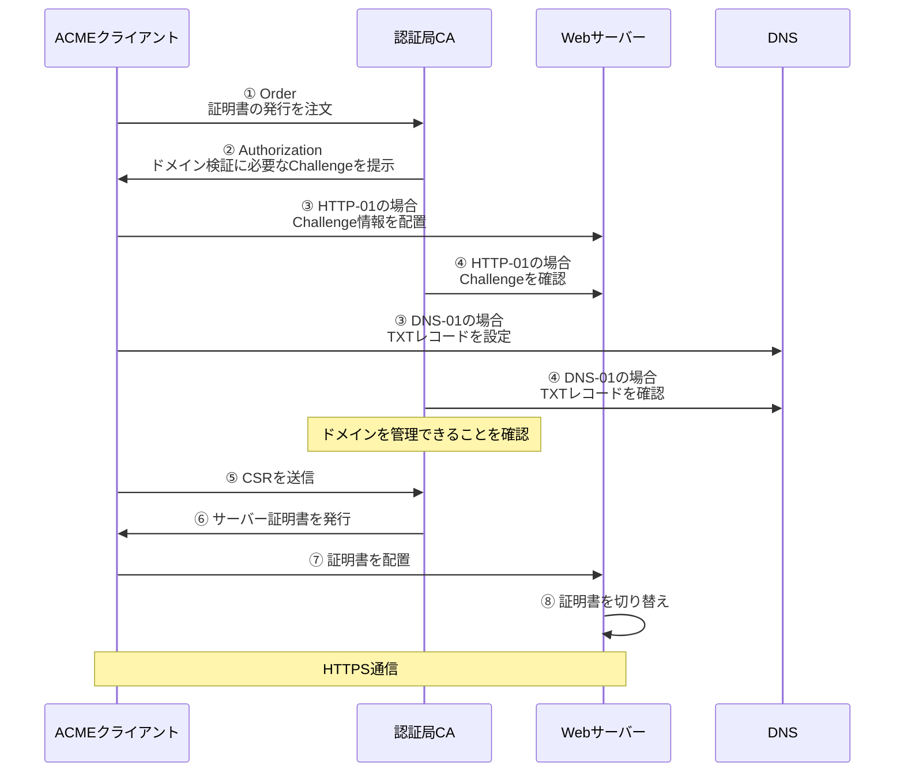
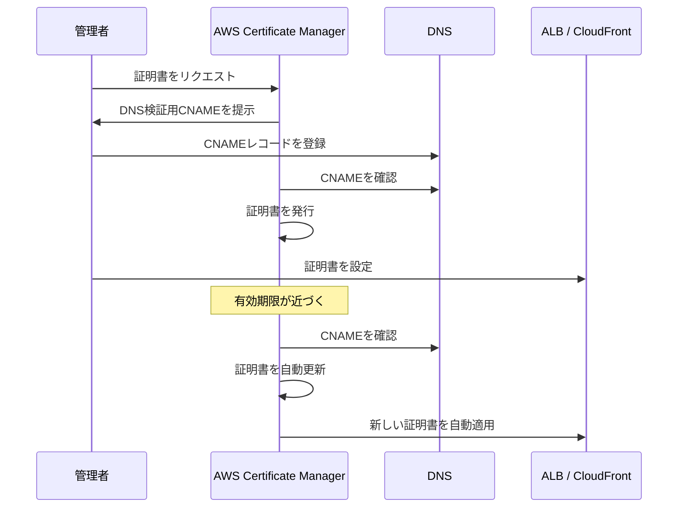

import Header from '../../../components/Header.astro'

<Header {...frontmatter} />

Webサイトで`https://`を使う場合に必要となるのがSSL/TLSサーバー証明書（以下、「証明書」と呼ぶ）だ。この証明書とは何なのか、なぜ必要でブラウザやWebサーバーでどのように利用されるのか、さらには証明書の運用（自動更新やその仕組み）などを整理する。

## なぜ証明書が必要なのか

HTTPS（HyperText Transfer Protocol Secure）は、従来のHTTPにSSL/TLS（Secure Sockets Layer/Transport Layer Security）という暗号化技術を組み合わせた通信規格である。

※SSLは実質的に廃止されておりHTTPS通信ではTLSを使うが、長らく使われてきて定着しているため、いまでも「SSL証明書」という表記が見られる

現在の主要ブラウザは、`http://`のWebサイトにアクセスすると「このサイトへの接続は保護されていません」など警告が表示されるようになった。そのため、**個人情報や機密情報を扱わないWebサイトであっても、通信先が本当に目的のドメインなのかを確認するためにもHTTPS通信が推奨されている。**

本物だと証明するために、認証局（CA:Certificate Authority）で発行された証明書を使う。

## 証明書は何を証明するのか

**証明書は主にドメイン名、公開鍵、証明書の有効期限、発行した認証局、その他証明情報などが含まれている。**

以下は`*.google.com`が使っている証明書の例だ。
```
[SSL/TLS証明書]

# 発行先
- 一般名（CN:Common Name）: *.google.com
- 組織（O:Organization）: <証明書に含まれていません>
- 組織単位（OU:Organization Unit）: <証明書に含まれていません>

# 発行元
- 一般名: WR2
- 組織: Google Trust Services
- 組織単位: <証明書に含まれていません>

# 有効期間
- 発行日:	2026年9月11日金曜日 4:21:53
- 有効期限: 2026年12月4日金曜日 4:21:52

# SHA-256 フィンガープリント
- 証明書: xxxxxxxx
- 公開鍵: xxxxxxxx
```

この証明書に記載された公開鍵は、このドメイン（上記の場合は`*.google.com`）を管理できる人のものであるということを、認証局の署名によって証明する。


## なぜ認証局や証明書を信頼できるのか

証明書に情報が入っているだけで、なぜそのWebサイトが本物だと言えるのか。

**ブラウザやOSには、あらかじめ信頼する認証局の情報が登録されている。** Webサーバーが証明書を提示すると、ブラウザは証明書の署名や接続先のドメイン名、有効期間などを検証するという仕組みで信頼している。

実際の証明書はひとつの認証局だけでは完結せずに、上位の証明書が次の証明書に、次の証明書がさらに次の証明書へと連鎖的に署名している。このように信頼関係を連鎖させる仕組みを信頼の連鎖（Chain of Trust）と呼ぶ。

このチェーンの最上位にある証明書がルート証明書で、信頼の起点でトラストアンカーと呼ぶ。

中間にある証明書は、中間CA証明書と呼ばれ、多くの場合は1〜2つ設定されている。

最後に実際にWebサイト管理者が設定するのが、サーバー証明書でこのドメインとサーバーが紐付けられていることを担保する。

## 認証局が証明書を発行する条件

認証局が証明書を発行する前に、以下のようにドメイン検証を行う。

### HTTP-01チャレンジの場合

**HTTP-01チャレンジは、該当ドメインのWebサーバーを操作できる権限を持っていることを証明するための方式。**

1. 認証局: ある文字列を`example.com/.well-known/acme-challenge/<TOKEN>`に配置するように指示する
2. 管理者: 管理するサーバー（example.comが向いているサーバー）に指定されたファイルを配置する
3. 認証局: HTTPでアクセスし、該当のファイルが確認できれば「サーバーを管理できる人」だと判断する

### DNS-01チャレンジの場合

**DNS-01チャレンジは、該当のドメインのDNSを変更できる権限を持っていることを証明するための方式。**

1. 認証局: ある値をDNSに登録するように指示する
2. 管理者: TXTレコードに指定された値を設定する
3. 認証局: DNSを検索し、指定したレコードが確認できれば「ドメインを管理できる人」だと判断する

### チャレンジ方式の違い

||HTTP-01|DNS-01|
|---|---|---|
|証明するもの|サーバーを操作できる|DNSを操作できる|
|配置場所|Webサーバー|DNSレコード|
|使用プロトコル|HTTP|DNS|
|ワイルドカード証明書|不可|可能|

`*.example.com`のようなワイルドカード証明書を発行してもらうには、DNSを操作できる権限を持っていることを証明しなければならないため、DNS-01チャレンジが必須となる。

`*.example.com`のワイルドカード証明書が発行されると`api.example.com`や`www.example.com`など複数のサブドメインをまとめて扱うことができる。

## 証明書の発行・設定手順

証明書を発行するには以下の手順を行う。

1. 管理者: サーバー側で鍵ペア（公開鍵/秘密鍵）を生成する
2. 管理者: 公開鍵を含めて証明書の申請を行う
   - 必要に応じてCSR（Certificate Signing Request:証明書署名要求）を作成する
   - CSRには公開鍵やドメイン名（FQDN）、国名、組織などの識別情報が含まれる
3. 管理者: 認証局の指示に従いドメイン検証のための準備をする（ファイルを配置する、DNSレコードを設定するなど）
4. 認証局: ドメイン検証を行う
5. 認証局: チャレンジが成功すれば証明書（サーバー証明書）を発行する
   - 中間CA証明書を提供される
6. 管理者: Webサーバーに発行された証明書を設定する
   - サーバー証明書と中間CA証明書を結合してfullchain証明書を作る
7. 管理者: Webサーバーの設定を変更する

Nginxを使っている場合なら、`/etc/nginx/conf.d/example.com.conf`に以下のような設定をする。

```
server {
  # ポートの設定
  listen 443 ssl;
  listen [::]:443 ssl;

  # 証明書の設定
  # 認証局が発行したサーバー証明書 + 中間CA証明書
  ssl_certificate     /etc/nginx/ssl/example.com.fullchain.crt;
  # 最初に作った鍵ペアの秘密鍵
  ssl_certificate_key /etc/nginx/ssl/example.com.key;

  ...
}
```


## HTTPS通信で何が起こるのか

実際のブラウザとWebサーバーのやりとりは以下のような流れになる。



証明書は「この公開鍵は、このドメインのものである」という身元確認の役割を担っている。そのうえでTLSの仕組みによって通信を暗号化する。

## 証明書の有効期間と自動更新

例として、Let's Encryptの証明書の有効期間は執筆時点（2026年10月）では90日に設定されている。しかし、昨今の業界全体のセキュリティ対策の流れを受け、今後は有効期間を45日へ段階的に短縮する方針が示されている。

ここで厄介なので、サーバー証明書の有効期間内に更新作業が必要となる。さらに複数台のWebサーバーを運用している場合は、1ヶ月ごとに新しい証明書を発行し、全サーバーに配布しなければならない。（証明書の発行方法は「証明書の発行・設定手順」の章を参照）

**この作業を自動化するためには、ACME（Automatic Certificate Management Environment）という認証局と利用者との間で証明書の発行や検証などを自動化するための通信プロトコルを利用する。**

なお、ACMEは[RFC 8555](https://datatracker.ietf.org/doc/html/rfc8555)で標準化されている。

## ACMEを使った証明書の自動更新

ACMEクライアントを使った証明書の自動更新フローは以下のとおり。ACMEクライアントと認証局とのやり取りでACMEプロトコルが使われている。



### 補足: ACMEアカウントと認証局のアカウントを紐づける

EAB（External Account Binding）は、主に認証局が発行するキーIDとHMAC Keyのペアで、ACMEアカウントと認証局側の契約・アカウントを紐づけるために使われる。

ただし、認証局によっては不要になる。（Let's Encryptは不要）


## マネージド証明書管理サービスを利用する

ここまで、証明書の発行からドメイン検証、WebサーバーやDNSの設定、そして定期的な更新作業まで説明してきた。

これらの作業を任せられるのが、マネージド証明書管理サービス（例: AWS Certificate Manager（以下、ACMという））だ。

ACMは、AWS上で証明書を管理するためのサービスで、AWSが発行する証明書を取得したり、既存の証明書をインポートしたりできる。また、CloudFrontやElastic Load Balancingなど、ACMと統合されたAWSサービスと連携して、取得した証明書を簡単に配布できる。

## マネージド証明書管理サービスを利用するメリット

ACMで公開証明書を取得する場合は、以下のような流れになる。


これまで説明してきた作業のウチ、証明書の発行、ドメイン検証、証明書の更新、新しい証明書の配布をACMに任せられる。

## さいごに

**証明書は「この公開鍵は、このドメインのものだ」ということを認証局が証明するための仕組みである。こうした証明があることで、利用者（ブラウザ）は通信相手のドメインを確認したうえで安全にWebサーバーと通信できるようになる。**
